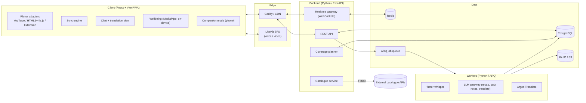
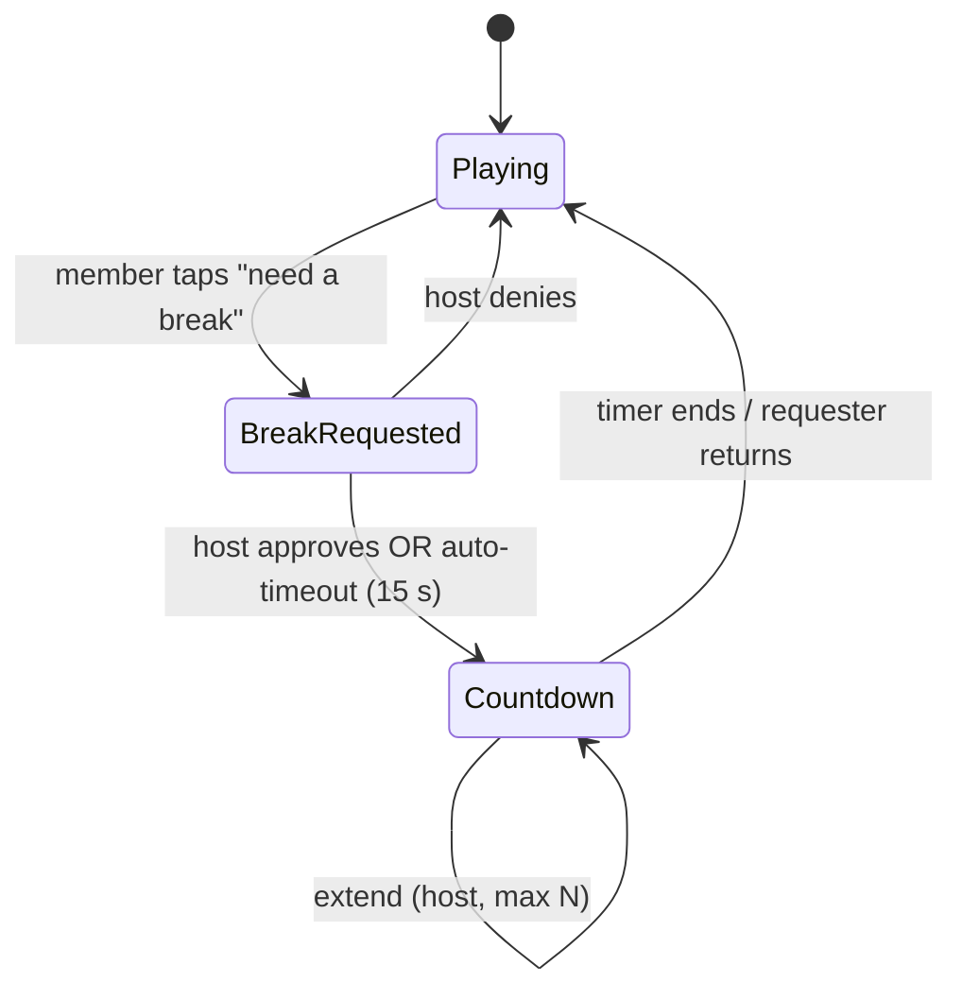
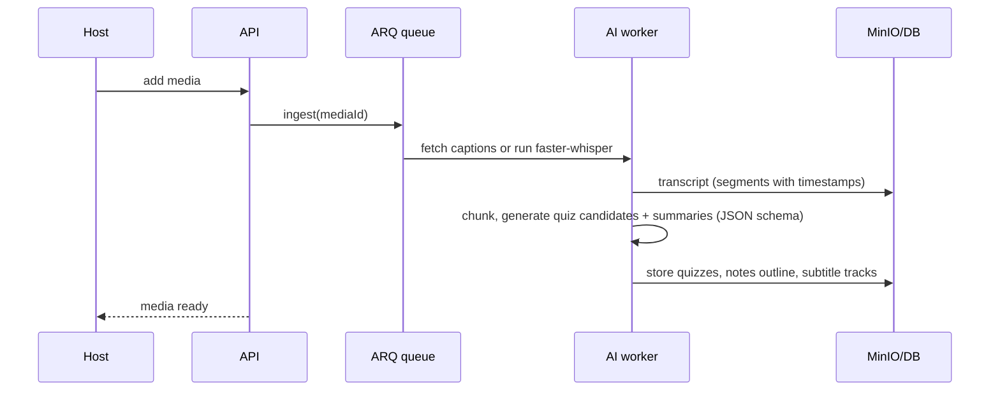

# WellPlayed Architecture

This document turns the feature set in the [README](../README.md) into a buildable design: system shape, workflows, tools, algorithms and delivery order. Open-source packages are preferred throughout. Where a choice is a judgement call, the alternative is noted.

## 1. Guiding principles

1. **Sync playback, never content.** We exchange timestamps and control events only. No restreaming, no screen capture, so DRM and platform terms stay intact.
2. **One core, thin modes.** Sync, chat, voice, language and wellbeing are shared services. Modes (Movie, Study, Sports, Hangout) are configuration plus a few mode-specific modules.
3. **Privacy by construction.** Camera frames are processed on-device. Only small derived states (e.g. `posture=slouch`) leave the device, and only with opt-in.
4. **Server is the clock, clients follow.** One authoritative room timeline; clients correct drift locally.
5. **Boring, typed, testable.** Python for the whole backend (including AI), TypeScript for the frontend. Shared contracts are generated from the Pydantic models, so the two sides cannot drift apart.
6. **Degrade gracefully.** If AI, camera or translation is unavailable, playback and chat still work.

## 2. System overview



One FastAPI codebase (a modular monolith) serves the REST API and the realtime gateway, with the planner and catalogue as modules. Heavy work (transcription, LLM calls, translation batches, clip rendering) runs in separate ARQ worker processes from the same codebase, so the sync path never blocks on it. Python's async I/O handles thousands of concurrent WebSockets per instance because sync traffic is tiny, and more instances scale out behind a load balancer with Redis pub/sub sharing room state. Modules can be split into services later without changing contracts.

## 3. Tooling choices

| Concern | Choice | Why / alternatives |
|---|---|---|
| Repo | Single repo: `backend/` (uv-managed Python) and `frontend/` (pnpm), with Docker Compose | Simple; add Turborepo only if more JS packages appear |
| Backend language | **Python 3.12** | One language for API, realtime and AI |
| Backend framework | **FastAPI** + **Pydantic v2**, served by **uvicorn** (gunicorn workers in prod) | Async, typed, auto OpenAPI |
| Realtime | FastAPI **WebSockets** with a Redis pub/sub room hub; **python-socketio** if built-in rooms/reconnect are preferred | Colyseus-style server simulation is unnecessary here |
| Frontend | **React + Vite** SPA/PWA, TypeScript, **TanStack Query**, **Zustand**, **React Router**, Tailwind CSS, shadcn/ui | Realtime logged-in app, so SSR adds little; Vite is fast to build. A landing page can be added later |
| API types | **openapi-typescript** generates the client types from FastAPI's OpenAPI; socket events exported from Pydantic as JSON Schema and compiled with **json-schema-to-typescript** | Single source of truth in Pydantic |
| Voice / video | **LiveKit** (open-source WebRTC SFU, self-host or Cloud) + `livekit-client` | Far less work than raw WebRTC; has data channels, recording hooks |
| Video playback | **YouTube IFrame API**, **hls.js**, **Video.js** or **Vidstack** | Player adapter interface hides differences |
| Third-party services (Household Mode) | **WXT** browser extension (controls the page's `<video>` element) | Only practical way to sync a user's own Netflix/Prime tab without touching the stream |
| DB | **PostgreSQL** + **SQLAlchemy 2 (async)** + **Alembic** migrations | SQLModel is a lighter alternative |
| Cache / pub-sub / room state | **Redis** | |
| Jobs | **ARQ** (Redis, async) | Transcription, quiz generation, clip rendering. Celery if complex scheduling is needed |
| Object storage | **MinIO** (S3-compatible) | Transcripts, subtitles, clips |
| Auth | **fastapi-users** or **Authlib** (email/OAuth, JWT) plus guest join via invite link | |
| Pose / blink / phone | **MediaPipe Tasks Vision** (Pose Landmarker, Face Landmarker blendshapes, Object Detector) via WASM/WebGPU | On-device, free |
| Avatars / transformations | **Rive** or **lottie-web** overlays, Framer Motion | |
| Speech to text | **faster-whisper** (self-hosted), or official captions when present | whisper.cpp for CPU-only deploys |
| LLM | **Claude API** behind a provider-agnostic gateway (**LiteLLM** if multi-provider is wanted) | Structured JSON output for quizzes/recaps |
| Chat translation | **Argos Translate** / **LibreTranslate** (self-hosted, free) with LLM fallback for slang | NLLB-200 for more languages |
| Subtitles | **WebVTT** + `<track>`, parsed with **webvtt-parser** / **subtitle** | |
| Catalogue data | **TMDB API** (watch providers per region) | Check TMDB terms for commercial use; provider data is JustWatch-sourced and needs attribution |
| Swipe UI | **Framer Motion** gestures (or `react-tinder-card`) | |
| Optimisation | Greedy weighted set cover first; **HiGHS** (`highspy`) or **OR-Tools** for exact ILP | Small instances, so exact solve is cheap |
| Clips (stretch) | **ffmpeg** worker | |
| i18n | **react-i18next** | |
| Observability | **OpenTelemetry**, **Prometheus + Grafana**, **Sentry** (self-hostable), **structlog** logs | |
| Testing | **pytest** + pytest-asyncio, **Vitest** (frontend), **Playwright** (multi-browser sync tests), **k6** (load) | |
| Quality | **Ruff** + **mypy** (backend), ESLint, Prettier, `tsc --strict` (frontend), **pre-commit** | |
| CI/CD | **GitHub Actions**, Docker, Docker Compose locally | Deploy to Fly.io / Railway for demo, Kubernetes later |

## 4. Repository layout

```
WellPlayed/
├─ backend/
│  ├─ app/
│  │  ├─ api/            REST routes (rooms, media, polls, planner, catalogue)
│  │  ├─ realtime/       WebSocket gateway, room hub, timeline state machine
│  │  ├─ modules/        sync, breaks, polls, planner, queue, wellbeing events
│  │  ├─ ai/             LLM gateway, recap, quiz, notes, translation
│  │  ├─ workers/        ARQ jobs (ingest, ASR, subtitles, clips)
│  │  ├─ models/         SQLAlchemy models + Pydantic schemas (source of contracts)
│  │  └─ data/           services.json (plans, prices, last-verified dates)
│  ├─ migrations/        Alembic
│  └─ tests/
├─ frontend/
│  ├─ src/
│  │  ├─ features/       room, companion, planner, swipe, study, sports, hangout
│  │  ├─ lib/sync-core/  Clock sync + drift correction (pure TS, unit-tested)
│  │  ├─ lib/players/    YouTube, HTML5/HLS, extension adapters
│  │  ├─ lib/wellbeing/  MediaPipe wrappers + posture/blink/stretch state machines
│  │  ├─ api/            Generated types and client
│  │  └─ components/
│  └─ tests/
├─ extension/            WXT extension for Household Mode
├─ infra/                docker-compose, Caddy, LiveKit config, CI helpers
└─ docs/
```

## 5. Core subsystems

### 5.1 Room model and state

A **room** has a mode, members, optional **households** (group of members sharing one screen/account), a **timeline** and a **queue**.

Authoritative timeline stored in Redis (`room:{id}`):

```
{ mediaId, state: playing|paused|buffering|countdown,
  anchorServerTime, anchorMediaTime, rate, version }
```

Current position = `anchorMediaTime + (serverNow - anchorServerTime) * rate`. Every control action bumps `version`, so late or duplicated messages are ignored.

### 5.2 Smarter Sync

**Clock sync.** On connect, and every 30 s, each client runs an NTP-style ping exchange over the socket: `offset = ((t1 - t0) + (t2 - t3)) / 2`, keeping the median of the best (lowest RTT) 5 samples.

**Drift correction** (in `sync-core`), evaluated every 500 ms against the expected position:

| Drift | Action |
|---|---|
| < 80 ms | none |
| 80 ms – 2 s | nudge `playbackRate` to 0.95 / 1.05 until converged |
| > 2 s | hard seek |

**Household Mode** uses the same engine. Each household's player is just another client whose adapter is the extension, so five TVs converge to the same timeline.

**Pause requests.** State machine per room:



During `Countdown` the room is paused with a visible resume time and reason. Rules (auto-approve threshold, max pause length) are per-room settings.

**Buffer forecasting.** Clients send telemetry every 2 s: buffered-ahead seconds, estimated bandwidth (hls.js estimate, Network Information API where available), dropped frames. The server keeps an EWMA per member and computes a **group ready-horizon** = min over members of `bufferAhead + predictedGrowth`. Policy:

- If any member's predicted buffer falls below a safety threshold within the next 10 s, tell the other clients to preload further and, if still unsafe, schedule a **planned pause** (shown as "Resuming in 0:10, Sam's connection is catching up") instead of letting a stall pause everyone abruptly.
- Start with this heuristic. Add ML only if data shows it is worth it.

**Late-joiner catch-up.** The backend holds a timestamped transcript (see 5.7). On join at time T, the recap job receives only transcript segments with `end <= T`, so it cannot leak later plot. Output is cached per (media, 5-minute bucket).

### 5.3 Companion Phones

Same web app, route `/room/:id/companion`. A phone joins as a **device** under the same member. It has chat, voice (LiveKit), reactions, polls and swipe. The big-screen client holds the player. Pairing is via QR code containing a short-lived signed token. Device roles: `screen`, `companion`.

### 5.4 Multilingual

- **Chat.** Message stored once in the sender's language. On send, the server fans out to the set of target languages present in the room, translating via Argos/LibreTranslate (LLM fallback when confidence is low or text is slang-heavy). Each client renders its own language with a "show original" toggle. Translations are cached by hash.
- **Subtitles.** Source: provided captions, else Whisper. Translated per cue batch (preserving cue timing) and stored as WebVTT in object storage, one file per language. Each client attaches its own `<track>`. Size and font are local preferences.

### 5.5 "Are You Still Human?" wellbeing

Runs entirely in the browser (`frontend/src/lib/wellbeing`), opt-in per member.

| Signal | Method |
|---|---|
| Slouch | Pose Landmarker: ear-shoulder-hip angle and head forward offset vs a calibrated baseline, smoothed over 10 s |
| Not blinking | Face Landmarker blendshapes `eyeBlinkLeft/Right`; alert if no blink for N seconds |
| Sitting too long | Timer plus pose presence |
| Phone pickup / dozing (Study) | Object Detector (COCO "cell phone"), eye-closure ratio over time |
| Stretch completion | Pose state machine: `seated → standing` then rep counter for a 30 s routine; seated alternative routine uses arm/torso landmarks |

Only a small state event leaves the device: `{member, avatarState: shrimp|fish|potato|animal|normal, since}`. Frames, landmarks and images are never uploaded or stored. The host can set a global accessibility profile (seated mode only, disable shaming transformations).

**Next-episode lock.** Server tracks `stretchStatus` per member. The next item starts only when all opted-in members report `done` or are excused by the host. A group countdown shows who is pending.

### 5.6 Engagement

- **Polls / quizzes / predictions.** Generic `Poll` entity (`open_at_media_time`, `lock_at`, `reveal_at`, options, scoring rule). Answers are locked server-side with a server timestamp, so predictions cannot be changed after the fact. Scores accumulate on a leaderboard per session.
- **Reaction heatmap.** Reactions are stored with `mediaTime`. Aggregated into 5-second bins per reaction type, rendered as a timeline (Recharts or visx).
- **Highlight reel (stretch).** Top bins become clip candidates; ffmpeg worker renders only from content the group already has rights to (e.g. their own recording of reaction video or YouTube-licensed material), opt-in only.

### 5.7 AI pipeline



- Everything heavy is **precomputed at ingest**, so live sessions only read cached results.
- LLM output uses strict JSON schemas (Pydantic validation, retry on invalid output).
- Prompts for recap include an explicit "no information after timestamp T" guard, and the input is physically truncated at T.
- Live sports has no transcript ahead of time, so quizzes there are replaced by prediction polls created by the host or from templates.

### 5.8 Movie Night: Coverage Planner and "What can we all watch?"

**Data**
- `households(id, room_id, region, members)`
- `household_services(household_id, service_id, plan, seats_free)`
- `services(id, name, regions, price_by_region, max_screens, free: bool)`
- `title_availability(title_id, service_id, region)` from TMDB watch-providers, refreshed on a schedule and cached.

**Algorithm**
1. For a chosen title (or the intersection of the swipe winners), compute for each household the set of services that carry it in its region.
2. Households already covered need nothing.
3. For uncovered households, generate fixes with a cost: join another household's screen (cost 0 if `seats_free`), add an extra member to an existing plan (service-specific price), pick a free service carrying the title (SBS On Demand, ABC iview, YouTube), or buy a plan.
4. Choose the set that covers all households at minimum added cost. This is weighted set cover; for room-sized inputs (≤ ~30 households, ~15 services) solve exactly with **HiGHS**, with a greedy fallback. Output: ranked options with explanation ("Covers 5/5 homes, extra A$0").
5. "What can we all watch?": rank titles by `covered_households / total` then by cost then by group preference score.

Prices and plan rules change often, so they live in a maintained data file (`backend/app/data/services.json`) with a last-verified date, not scraped.

**Swipe-to-vote.** Shared deck from the candidate list. Each swipe records `like/dislike/superlike`. Ranking = approval voting with veto (a dislike from a household that cannot access the title excludes it). Results update live over the socket.

### 5.9 Study Mode

- Media from any recording (uploaded file via MinIO, YouTube, or openly licensed lecture URL).
- Quiz breaks: at ingest, pick pause points by topic-shift detection (LLM over transcript chunks, or sentence-embedding similarity drops with `sentence-transformers`), generate N questions per break. At playback the room pauses, questions appear on phones, **fastest correct answer** scores using server-received timestamps.
- Focus check uses the wellbeing module with the animal transformation.
- End-of-session **AI notes**: summary and key points with `[mm:ss]` links that seek the player.

### 5.10 Sports Mode: spoiler-safe live sync

Live streams are delayed differently per viewer. Rather than forcing one delay, we make **everything social content-time aligned**:

1. Each viewer's player reports a **live-edge timestamp**: HLS `EXT-X-PROGRAM-DATE-TIME` where available, otherwise a manual one-tap calibration ("tap when you see the kickoff whistle"), producing a per-viewer `delay` relative to a reference.
2. Every reaction, prediction lock and chat marker is stamped with the **sender's content-time** (`wallclock - delay`).
3. The receiving client **buffers** the event and releases it only when its own content-time reaches the stamp. A fast viewer's cheer is held until the slower viewer sees the goal.
4. Optional "sync to slowest" mode seeks fast viewers back inside their DVR window to match.

Chat text sent as plain messages is held back the same way when spoiler-safe is on. Live predictions lock at the content-time they were made, preventing "predict after seeing" cheating.

### 5.11 Hangout Mode

- Shared queue (ordered list in Postgres, live state in Redis), add by YouTube URL (title/duration via YouTube oEmbed or the Data API), votes to skip with a threshold.
- Audio-first: player minimised, optional low-quality stream via the IFrame API quality hint, or audio-only for self-hosted media. The UI foregrounds LiveKit voice.
- Drop-in/out: membership changes never touch the timeline; a joining client simply receives the current timeline snapshot.

## 6. Key workflows

**Create and join.** Host creates room, picks mode, gets invite link and QR. Guests join with no account (display name, language). Households are formed by members tagging "same home" or the host assigning them.

**Movie night (end to end).**
1. Invite members, each adds household and services, regions detected from locale (editable).
2. Swipe-to-vote builds the shortlist, planner filters by coverage, the group picks.
3. Each household opens the title on its own service (extension attaches to the tab) or the host pastes a YouTube/open link.
4. Sync engine aligns all players, voice/chat on companion phones, predictions and reactions run.
5. After the film: heatmap, prediction reveal, optional highlight reel.

**Study session.** Share a lecture, ingest runs (captions, quizzes, notes), play with focus checks, quiz breaks, leaderboard, notes export.

## 7. Data model (core tables)

`users`, `rooms`, `members`, `households`, `devices`, `media`, `transcript_segments`, `subtitle_tracks`, `queue_items`, `polls`, `poll_options`, `poll_answers`, `reactions`, `messages`, `message_translations`, `services`, `household_services`, `title_availability`, `quizzes`, `session_summaries`, `wellbeing_events` (state only, no raw data, TTL).

## 8. Realtime contract (representative)

All events are Pydantic models in `backend/app/models`, versioned, exported as JSON Schema and compiled to TypeScript types for the frontend.

| Event | Direction | Notes |
|---|---|---|
| `clock:ping/pong` | both | offset estimation |
| `timeline:set` | client → server | play / pause / seek (host or permitted) |
| `timeline:state` | server → clients | full timeline with `version` |
| `break:request/decision` | both | pause-request flow |
| `telemetry:buffer` | client → server | buffer and bandwidth |
| `chat:send` / `chat:message` | both | translations attached per target language |
| `reaction:send` / `reaction:event` | both | content-time stamped |
| `poll:*` | both | open / answer / lock / reveal |
| `wellbeing:state` | both | avatar state only |
| `lock:status` | server → clients | next-episode lock progress |
| `queue:*` | both | hangout queue |

## 9. Security, privacy, compliance

- Camera is opt-in, processed in-browser by MediaPipe WASM, no frame or landmark leaves the device. Document this in the UI and verify with a network-tab test in CI (Playwright asserts no media upload requests).
- Short-lived signed room tokens, per-room permissions (host, co-host, member), rate limiting (`slowapi` or a Redis token bucket), input validation (Pydantic), CSP headers, DOMPurify for chat.
- LiveKit tokens minted server-side, scoped per room.
- Data retention: chat and wellbeing events auto-expire; users can delete their data. Follows GDPR/Australian Privacy Act principles.
- Extension requests minimal host permissions and only reads/controls the `<video>` element's time and play state.
- Copyright: no ingestion of protected streams. Demo content is YouTube, royalty-free and openly licensed lectures.

## 10. Quality plan

| Level | What |
|---|---|
| Unit | `sync-core` in Vitest (drift math with simulated clocks), timeline state machine in pytest, planner (golden cases), state machines |
| Integration | Server with real Redis/Postgres via Testcontainers (Python) |
| E2E | Playwright with 3+ browser contexts asserting `|drift| < 150 ms` after seek/pause/break |
| Network chaos | Throttle and latency injection (Playwright CDP, `toxiproxy`) for buffer forecasting |
| Load | k6 with simulated rooms (target: 500 rooms × 20 members on one instance) |
| AI | Fixed fixtures; assertion that recap never contains post-timestamp keywords; schema validity rate |
| Accessibility | axe-core in Playwright, seated stretch alternative tested |

## 11. Deployment

- **Local:** `docker compose up` brings up Postgres, Redis, MinIO, LiveKit, server, web, AI.
- **Demo/staging:** Fly.io or Railway for web/server, LiveKit Cloud or one small VM, Cloudflare in front.
- **Scale path:** Backend instances behind a load balancer (Redis pub/sub for room fan-out), room affinity not required. Stateless API. ARQ workers scale on queue depth.

## 12. Delivery plan

Each item below is its own feature branch off `dev` (see `CLAUDE.md`).

| # | Branch | Outcome |
|---|---|---|
| 0 | `chore/project-setup` | `backend/` (uv, FastAPI skeleton) and `frontend/` (Vite) scaffolds, lint, CI, docker-compose |
| 1 | `feature/rooms-and-auth` | Create/join rooms, guests, members |
| 2 | `feature/synced-playback` | `sync-core`, YouTube + HTML5 adapters, drift tests |
| 3 | `feature/chat-and-voice` | Chat, LiveKit voice/video, companion pairing |
| 4 | `feature/pause-requests` | Break state machine, countdown |
| 5 | `feature/multilingual-chat-subtitles` | Translation service, per-user subtitles |
| 6 | `feature/polls-and-reactions` | Polls, predictions, heatmap |
| 7 | `feature/ai-ingest-and-recap` | Transcripts, late-joiner recap |
| 8 | `feature/movie-night-planner` | Households, coverage planner, swipe-to-vote |
| 9 | `feature/household-extension` | Browser extension adapter |
| 10 | `feature/healthy-watching` | MediaPipe signals, avatars, next-episode lock |
| 11 | `feature/study-mode` | Quiz breaks, leaderboard, notes |
| 12 | `feature/sports-mode` | Delay calibration, content-time event release |
| 13 | `feature/hangout-mode` | Queue, skip votes, audio-first |
| 14 | `feature/buffer-forecasting` | Telemetry and planned pauses |
| 15 | `feature/highlight-reel` | Stretch goal |

**Hackathon cut line:** items 0–8, 10 and one of 11/12/13 give a convincing demo. Items 9, 14 and 15 follow.

## 12a. Implementation status

Delivered on feature branches (see git history). Differences from the design above:

- Room state is in memory behind `RoomManager`/`Hub`; Redis and Postgres are the planned stores.
- The coverage planner uses exact subset enumeration (no HiGHS dependency needed at this size).
- `highlights` returns clip time ranges; ffmpeg rendering is not built.
- Frontend styling is plain CSS (no Tailwind/shadcn yet).
- ASR, Argos translation and LiveKit are optional extras; every feature has a no-dependency fallback.

## 13. Risks and mitigations

| Risk | Mitigation |
|---|---|
| Streaming sites change their DOM/players | Extension relies only on the standard `HTMLVideoElement`; keep a manual "enter timestamp" fallback |
| Third-party player ads break sync | Detect ad state where possible; treat as `buffering` and wait |
| Live delay calibration is imprecise | Combine PDT where present with manual tap; allow re-calibration anytime |
| Pose detection accuracy / device performance | Throttle to 5–10 FPS, WebGPU when available, graceful off switch, calibrated thresholds |
| LLM cost and latency | Precompute at ingest, cache aggressively, small-model default |
| Catalogue data licensing | Abstract `CatalogueProvider`; fall back to curated JSON for demo |
| Translation quality | Show original on tap, LLM fallback, allow per-user disable |
| Spoilers in recap | Truncate input at T physically, regression tests |
